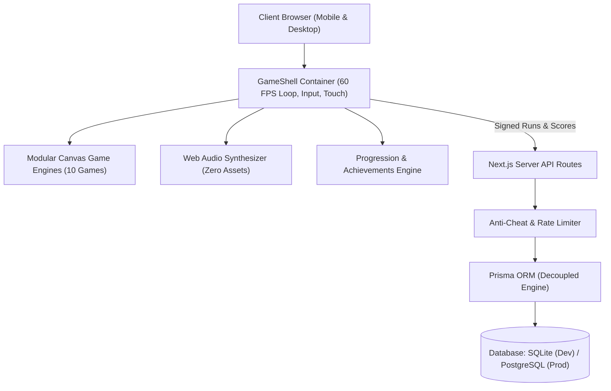

# ArcadePulse V2 — System Architecture Overview

## 1. Executive Summary

ArcadePulse V2 is a high-performance, mobile-first browser gaming platform engineered for instant 10–60 second competitive arcade play. Built on Next.js 14 with TypeScript, Tailwind CSS, HTML5 Canvas 2D, and Prisma ORM, ArcadePulse eliminates the barriers of app stores and mandatory accounts. Players jump straight into gameplay in under 3 seconds, compete on synchronized global daily challenges, and challenge friends via deterministic URL links.

---

## 2. Core Architectural Pillars

### 2.1 Decoupled Presentation & Game Logic
- **Game Shell (`src/components/GameShell.tsx`)**: High-level orchestrator handling game instance lifecycles, viewport scaling (`100dvh`), pause overlays (`ESC` key / button), score HUD, game-over screens, run token sessions, audio triggers, and social sharing.
- **Game Engines (`src/lib/games/*.ts`)**: Pure TypeScript classes adhering to the `GameInstance` interface. Engines interact solely with the canvas and input coordinates, remaining free of DOM pollution or React state overhead.

### 2.2 Delta-Time Normalization
In ArcadePulse V1, games moved objects by fixed pixel increments per animation frame. On modern 90Hz, 120Hz, and 144Hz displays, gameplay moved 1.5× to 2.4× faster than on standard 60Hz screens. In V2:
$$\Delta t_{\text{norm}} = \frac{\Delta t_{\text{ms}}}{16.6667}$$
All spatial translations, physics integration, gravity, and velocities multiply by this normalized factor, ensuring deterministic 60 FPS baseline physics across all device refresh rates.

### 2.3 Web Audio Synthesizer (`src/lib/audio.ts`)
ArcadePulse uses zero external MP3/WAV assets, reducing network payload and eliminates audio decode latency. All sound effects (taps, jumps, combos, game over, victories) are synthesized programmatically using the browser's native `AudioContext` with custom oscillators, gain envelopes, and frequency sweeps.

### 2.4 Anonymous Player Identity & Dual Persistence
- **Local Persistence**: `localStorage` maintains player anonymity, high scores, custom gamer tags, and achievement progression for instantaneous offline-capable feedback.
- **Server Persistence**: On game completion, the client submits verified scores to `/api/scores`. The backend synchronizes anonymous player profiles, tracks daily challenge rankings, and records global leaderboards.

---

## 3. Technology Stack Reference

| Layer | Technology | Purpose |
|---|---|---|
| **Framework** | Next.js 14 (App Router) | Server-side rendering, streaming, optimized bundle splitting |
| **Language** | TypeScript 5 | Strict typing across game engines, API payloads, and database schema |
| **Styling** | Tailwind CSS 3 | Modern dark arcade neon design tokens, fluid typography, responsive layout |
| **Renderer** | HTML5 Canvas 2D | Low-overhead 60 FPS graphics, hardware-accelerated draw calls |
| **Audio** | Native Web Audio API | Zero-bandwidth synthesized sound effects |
| **Database** | Prisma ORM | Type-safe migrations, decoupled SQLite (local) and PostgreSQL (cloud) |
| **Security** | In-Memory Sliding Window & Bounds Engine | Score plausibility validation, XSS sanitization, anti-cheat |
| **Testing** | Vitest 5 & Puppeteer-Core | Unit test suite and headless browser cross-platform E2E validation |
